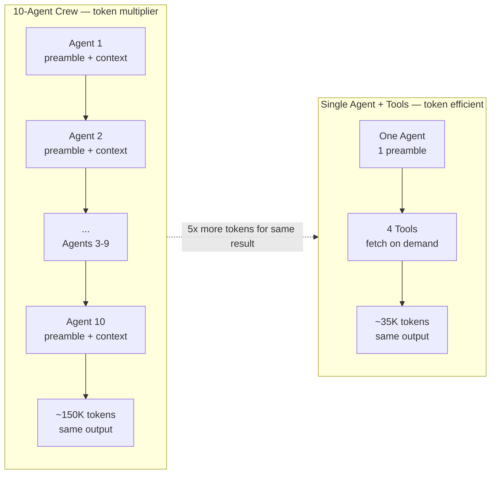
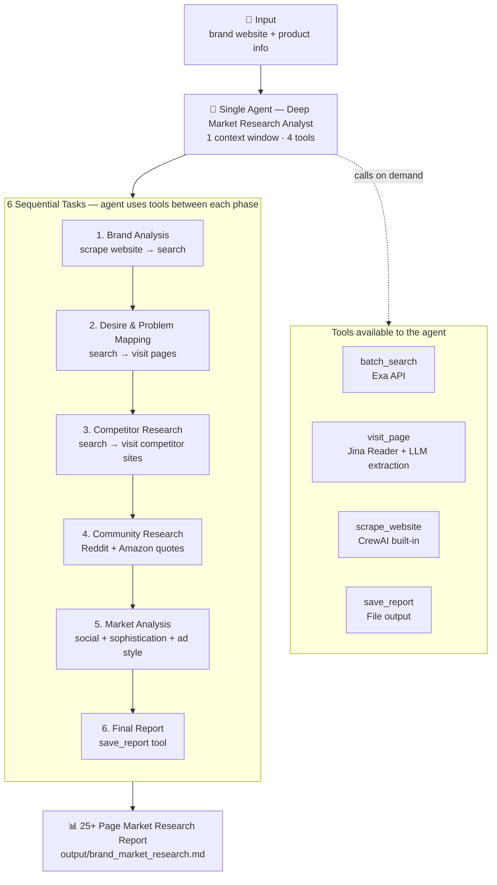

# Market Research Agent

A single-agent AI system built with CrewAI that conducts comprehensive market research on any brand or product. One agent equipped with multiple tools (web search, page reader, website scraper, report saver) works through a sequence of research tasks — from brand analysis through desire mapping, competitor research, community research, market analysis, and final report compilation.

## Why Single-Agent + Many Tools?

Earlier versions used 10 specialized agents, each with the same search tool. That approach was a **token multiplier** — 10 agents re-reading the same context = ~5x the token cost for the same output. The current design uses **one agent with many tools**, inspired by DeepResearch's pattern:

- **Jina Reader** (`visit_page` tool) fetches any URL and summarizes relevant info → saves context
- **Batch search** (`batch_search` tool) runs multiple Exa queries in one call → fewer round-trips
- **Sequential tasks** break the work into phases so the agent uses tools between each phase

### The Core Advantage

| Problem with 10-Agent Crew | How Single-Agent + Tools Solves It |
|---|---|
| 10 agents re-reading shared context = 5x tokens | One agent holds context once, tools fetch only what's needed |
| Each agent's preamble/role/backstory burns tokens | One agent, one preamble |
| Compounding context across agents | `visit_page` summarizes pages before storage |
| Hard to debug which agent failed | Single linear trace, easy to follow |
| Tools duplicated across agents | Tools owned by one agent, used on demand |



### Best Use Cases

1. **Launching a new product** — Understand the competitive landscape before entering a market
2. **Auditing your brand positioning** — See how customers really talk about your product vs competitors
3. **Finding advertising angles** — Discover authentic customer language for ad copy
4. **Competitive intelligence** — Systematic analysis of 10-15 competitors with source links
5. **Content strategy** — Identify viral hooks and content patterns in your niche

## How It Works



**Token-efficient design:** `visit_page` uses Jina Reader (`r.jina.ai/{url}`) to fetch full page content, then an LLM extracts only the relevant info — so the agent stores summaries, not raw HTML. This keeps context small even after visiting 20+ pages.

## Setup

### 1. Install Dependencies

```bash
git clone https://github.com/shipblueprint/deep-market-research-agent.git
cd deep-market-research-agent
uv sync
```

### 2. Configure API Keys

Copy the example env file and add your keys:

```bash
cp .env.example .env
```

Edit `.env`:

```env
LLM_PROVIDER=ollama_cloud
OLLAMA_API_KEY=your-ollama-cloud-api-key
EXA_API_KEY=your-exa-api-key
```

**Get API keys:**
- Ollama Cloud: https://ollama.com/settings/keys (free tier available)
- Exa Search: https://exa.ai (free tier available)

### 3. Run

#### Option A: Use an example input file
```bash
python market_research_crew.py input/example_saas.txt
```

#### Option B: Interactive mode
```bash
python market_research_crew.py
```
Then enter a brand website or pick from the listed examples.

#### Option C: Direct website entry
```bash
python market_research_crew.py
# Enter: https://www.notion.so
# Enter product info: All-in-one workspace
```

## Input Files

Pre-built examples in the `input/` folder show what you can research:

| File | Brand | Category |
|------|-------|----------|
| `example_saas.txt` | Notion | SaaS / Productivity |
| `example_ecommerce.txt` | Liquid I.V. | E-commerce / Beverage |
| `example_fitness.txt` | MacroFactor | App / Fitness |
| `example_course.txt` | ShipFast | Developer tool / Boilerplate |
| `example_supplement.txt` | AG1 | Supplement / Health |

### Create Your Own Input File

Create a `.txt` file in the `input/` folder with this format:

```
website: https://your-brand.com
product: Brief description of the product, target audience, and key value proposition.
```

Then run:
```bash
python market_research_crew.py input/your_file.txt
```

## LLM Configuration

The crew supports two LLM providers (configured in `.env`):

### Ollama Cloud (Free Tier — Default)
```env
LLM_PROVIDER=ollama_cloud
OLLAMA_API_KEY=your-key
```
- Uses `gpt-oss:20b-cloud` (free tier, good for testing)
- Switch to `gpt-oss:120b-cloud` for production quality (edit model name in code)
- Free tier limits: 1 concurrent model, session + weekly limits

### OpenAI (Paid)
```env
LLM_PROVIDER=openai
OPENAI_API_KEY=your-key
```
- Uses `gpt-4o-mini`
- Best quality but costs money

## Custom Prompts

The research methodology is defined in the `prompts/` directory — one file per research phase. This separation makes it easy to customize the methodology without touching the agent code.

### Directory Structure

```
prompts/
├── __init__.py              # Exports all prompts + reconstructs MARKET_RESEARCH_PROMPT
├── system_prompt.py         # Agent goal: tool usage guidelines + methodology intro
├── brand_analysis.py        # Phase 1: Brand & product analysis questions
├── desire_mapping.py        # Phase 2: Desires, problems, emotional drivers
├── competitor_research.py   # Phase 3-4: Competitors + identity markers
├── community_research.py    # Phase 5-6: Amazon + Reddit customer language
├── market_analysis.py       # Phase 7-9: Social media, sophistication, ad style
└── final_report.py          # Phase 10: Report compilation + ad concepts
```

### How Prompts Are Used

- **`SYSTEM_PROMPT`** → set as the agent's `goal` (defines overall behavior + tool usage)
- **Individual phase prompts** (e.g., `BRAND_ANALYSIS_PROMPT`) → injected into each `Task` description via f-string
- **`MARKET_RESEARCH_PROMPT`** → reconstructed combined prompt (backward compatibility, not used directly by the agent)

### Placeholders

Two placeholders are available in every prompt file — they get replaced at runtime with the user's input:

| Placeholder | Replaced with | Example |
|---|---|---|
| `{brand_website}` | The brand URL from the input file | `https://shipfast.dev` |
| `{product_info}` | The product description from the input file | `Next.js boilerplate for indie hackers` |

Use these in your prompt text to reference the target brand. They are substituted by CrewAI when the task runs.

### Writing Your Own Prompts

1. **Start from the example template** — copy `prompts.example/` into `prompts/`:
   ```bash
   cp prompts.example/*.py prompts/
   ```

2. **Edit each file** — each file defines one constant (e.g., `BRAND_ANALYSIS_PROMPT = """..."""`). Replace the example questions with your own research methodology.

3. **Keep the constant names** — `market_research_crew.py` imports these names:
   - `SYSTEM_PROMPT`, `BRAND_ANALYSIS_PROMPT`, `DESIRE_MAPPING_PROMPT`
   - `COMPETITOR_RESEARCH_PROMPT`, `COMMUNITY_RESEARCH_PROMPT`
   - `MARKET_ANALYSIS_PROMPT`, `FINAL_REPORT_PROMPT`

4. **Run** — `python market_research_crew.py input/example_saas.txt`

### Prompt Writing Tips

- **Be specific about counts** — "List 10-15 competitors" beats "List competitors"
- **Request direct quotes** — "Include 5-7 direct quotes with source links" ensures the agent uses tools, not assumptions
- **Specify output format** — "Document with specific examples and links" gives the agent a target structure
- **Map each phase to a tool** — if the phase needs web data, mention which queries to search (e.g., `site:reddit.com {brand}`)
- **Keep phases focused** — each file maps to one `Task` in `market_research_crew.py`. Don't cram unrelated research into one file.

### Licensing Note

The `prompts/` directory is **gitignored** by default (see `.gitignore`). This lets you keep proprietary or paid prompt methodology private while open-sourcing the agent code. The `prompts.example/` directory contains original, generic templates that are safe to commit and share.

If you wrote your own prompts from scratch and want to commit them, remove `prompts/` from `.gitignore`.

## Output

The crew produces a comprehensive market research document that includes:
- Brand positioning analysis
- Customer desire mapping with quotes
- Competitor landscape (10-15 competitors)
- Amazon review analysis (40+ customer quotes)
- Reddit community insights (50+ user quotes)
- Social media hook and visual analysis
- Market sophistication assessment
- 3+ ad concept recommendations
- Strategic roadmap

## Project Structure

```
deep-market-research-agent/
├── market_research_crew.py    # Main agent definition (agent, tasks, crew, CLI)
├── prompts/                   # Research methodology (gitignored — may be proprietary)
│   ├── __init__.py            #   Exports all prompts + MARKET_RESEARCH_PROMPT
│   ├── system_prompt.py       #   Tool usage + methodology intro
│   ├── brand_analysis.py      #   Phase 1: Brand & product analysis
│   ├── desire_mapping.py      #   Phase 2: Desires & problems
│   ├── competitor_research.py #   Phase 3-4: Competitors + identity
│   ├── community_research.py  #   Phase 5-6: Amazon + Reddit
│   ├── market_analysis.py     #   Phase 7-9: Social + sophistication + ad style
│   └── final_report.py        #   Phase 10: Report compilation
├── prompts.example/           # Public template (safe to commit/share)
│   └── (same file structure as prompts/, with generic example content)
├── tools/                     # Agent tools
│   ├── batch_search.py        #   Exa batch web search
│   ├── visit_page.py          #   Jina Reader + LLM extraction
│   └── save_report.py         #   Save report to file
├── input/                     # Example input files
│   ├── example_saas.txt
│   ├── example_ecommerce.txt
│   ├── example_fitness.txt
│   ├── example_course.txt
│   └── example_supplement.txt
├── output/                    # Generated reports (created at runtime)
├── .env                       # Your API keys (not committed)
├── .env.example               # Template for API keys
├── .gitignore                 # Excludes .env, prompts/, output/
├── pyproject.toml             # Python dependencies
└── README.md                  # This file
```

## Troubleshooting

**"No brand website provided"**
- Make sure your input file has `website: https://...` on the first line

**`ModuleNotFoundError: No module named 'prompts'`**
- The `prompts/` directory is gitignored. If you cloned the repo, copy the example:
  `cp prompts.example/*.py prompts/`

**API key errors**
- Verify keys in `.env` are correct
- Check that `.env` is in the project root

**Rate limit errors (Ollama free tier)**
- Wait 5 hours for session limits to reset
- Use a smaller model (already configured for testing)
- Switch `LLM_PROVIDER=openai` for higher limits (paid)

**Agent stuck or slow**
- This is normal — the agent visits 20+ pages across 6 phases
- Check console output for progress (verbose mode is on)
- If a phase fails, the agent retries automatically (max 25 iterations)
